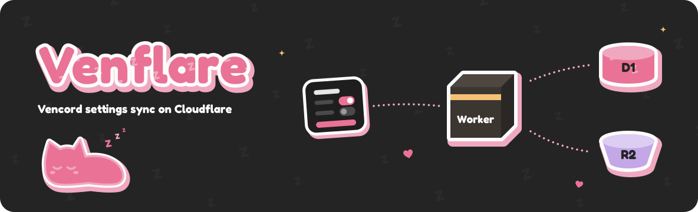

<p align="center">
  
</p>

<h1 align="center">Venflare</h1>

<p align="center">
  An experimental port of <a href="https://github.com/Vencord/Vencloud">Vencloud</a>,
  Vencord's Go cloud-sync API, to a Cloudflare Worker.
</p>

<p align="center">
  <a href="https://github.com/Vencord/Vencloud"></a>
  <a href="https://bun.sh"></a>
  <a href="https://developers.cloudflare.com/workers/"></a>
</p>

Venflare keeps your [Vencord](https://github.com/Vendicated/Vencord) settings in sync across devices. It's an experimental port of [Vencloud](https://github.com/Vencord/Vencloud), Vencord's Go sync API, to a Cloudflare Worker. You don't need a Go server or Redis.

> [!WARNING]
> Venflare is experimental. Keep your own exported copy of your settings, and don't rely on this as your only backup.
>
> Encryption happens on the server, not on your device. An operator who knows your Discord user ID and holds `PepperSettings` can decrypt your settings. [How your data is stored](#how-your-data-is-stored) has the details.

Venflare is a separate project, not an official Vencord service. Report problems here, not to the Vencord support server.

Venflare uses four services:

- **Cloudflare Workers** runs the API that Vencord talks to.
- **D1** stores account records.
- **R2** stores your encrypted settings in a private bucket.
- **Discord** signs you in. This API only requests the `identify` scope.

The goal is to work with existing Vencord clients. The tests cover OAuth, uploads, downloads, deletion, and timestamp ETags.

## What you need

- [Bun](https://bun.sh) 1.4.2 or newer.
- A Cloudflare account with [Workers Paid](https://developers.cloudflare.com/workers/platform/pricing/), D1, and R2 enabled. Cloudflare bills you for usage.
- A [Discord application](https://discord.com/developers/applications) for sign-in.

Cloudflare provides HTTPS, so you don't need a reverse proxy or Docker.

## Quick start

### 1. Install

From the project folder:

```sh
bun install
bun sst install
cp .env.example .env
```

### 2. Add your Cloudflare details

Open `.env` and fill in `CLOUDFLARE_API_TOKEN` and `CLOUDFLARE_DEFAULT_ACCOUNT_ID`. Don't commit this file.

To create the token, start from Cloudflare's **Edit Cloudflare Workers** template and add **Account → D1 → Edit**. If you want a custom domain, also add **Zone → DNS → Edit** for that zone. The [SST Cloudflare guide](https://sst.dev/docs/cloudflare/#credentials) covers the details.

### 3. Create a Discord application

In the [Discord Developer Portal](https://discord.com/developers/applications), create an application. Copy its **Application ID** and **OAuth2 Client Secret**. You don't need a bot.

### 4. Set the secrets

```sh
bun sst secret set DiscordClientId
bun sst secret set DiscordClientSecret
bun sst secret set DiscordRedirectUri
```

Leave off the value and SST asks for it. For `DiscordRedirectUri`, use this placeholder for now:

```text
https://example.com/v1/oauth/callback
```

You'll replace it in step 8, once you know your API address.

SST also generates two peppers, `PepperSecrets` and `PepperSettings`. A pepper is a random secret the server mixes into its hashes and keys. You don't need to copy anything from the Go server.

These commands write to your personal stage. A stage is a separate copy of the app with its own resources.

### 5. Start it

```sh
bun dev
```

This creates your Cloudflare resources, generates `sst-env.d.ts`, starts the Worker build watcher, and opens Drizzle Studio, a web app for your database. When the deploy finishes, copy the `api` URL that SST prints. That's your API address.

> [!NOTE]
> `bun dev` uses real Cloudflare resources. It isn't an offline server, and the resources stay around after you stop it. Use your personal stage for development, never `production`.
>
> If your terminal has no interactive UI, run `bun dev --mode=mono` instead.

### 6. Run the migrations

Leave `bun dev` running. In another terminal, run:

```sh
bun run db:migrate
```

### 7. Check the API

```sh
curl https://your-api-address/v1
```

You should get `{"ping":"pong"}`.

### 8. Set the real redirect URL

In the Developer Portal, open **OAuth2 → Redirects** and add:

```text
https://your-api-address/v1/oauth/callback
```

Then replace the placeholder with the same URL:

```sh
bun sst secret set DiscordRedirectUri
```

Sign-in won't work until both values match exactly.

## Connect Vencord

Open Vencord's **Cloud** settings, then:

1. Set **Backend URL** to your API address, without `/v1`.
2. Turn on **Enable Cloud Integrations**, then authorize your Discord application.
3. Turn on **Enable Settings Sync**.

Try **Upload Settings** and **Download Settings** before you rely on automatic sync. Repeat the setup on each device. Desktop Vencord may ask you to restart after you allow the new backend domain.

## Troubleshooting

- **Sign-in fails.** The redirect URL in Discord and `DiscordRedirectUri` must match exactly.
- **Someone can't sign in.** If `ALLOWED_USERS` is set, their Discord user ID has to be on the list.
- **Old backups won't download.** Backups from before the encryption change can't be read through the API. Upload your settings again.

## Deploy to production

Production is its own SST stage, with its own database, bucket, and secrets. It doesn't copy your development data. Run these from the project folder:

```sh
bun sst secret set DiscordClientId --stage production
bun sst secret set DiscordClientSecret --stage production
bun sst secret set DiscordRedirectUri --stage production
bun run deploy --stage production
bun sst shell --stage production -- bun run --cwd packages/storage db:migrate
```

If you don't have the production address yet, use the placeholder from step 4 for `DiscordRedirectUri`. After the deploy, set it to `https://your-production-api-address/v1/oauth/callback` and add that same URL to Discord's redirects. Then use the production API address in Vencord.

**Custom domain.** Set `DOMAIN` in `.env` before you deploy. The domain must be in a zone that Cloudflare manages. With a custom domain, your API address is that domain instead of the Worker URL. `DOMAIN` only applies outside dev mode. Dev always uses the generated Worker URL.

The SST app is named `vencloud-worker`. Keep that name if you already have a deployment. Renaming it creates a separate deployment, and it doesn't migrate stored settings.

## Configuration

Application secrets live in SST. Set them with `bun sst secret set <name>`. Put everything else in `.env`.

| Variable        | Default              | What it does                                                                           |
| --------------- | -------------------- | -------------------------------------------------------------------------------------- |
| `DOMAIN`        | Worker URL           | Custom domain for production. Dev mode ignores it.                                     |
| `ALLOWED_USERS` | Everyone             | Comma-separated Discord user IDs that can sign in and sync.                            |
| `SIZE_LIMIT`    | `32000000`           | Largest backup allowed, in bytes. You can lower it, but not above 32 MB.               |
| `PROMETHEUS`    | `false`              | Set to `true` to show a count of registered accounts at `/metrics`.                    |
| `SOURCE_URL`    | Unset                | Public link to your source code, shown on `/v1`. Must use HTTPS.                       |
| `ROOT_REDIRECT` | `SOURCE_URL`, if set | Where `/` redirects. If neither is set, `/` returns `{"ping":"pong"}`. Must use HTTPS. |

`SOURCE_URL` isn't a secret, and the app starts without it. If you publish a modified version, set it to your own repository.

Removing someone from `ALLOWED_USERS` blocks their sign-in and sync. They can still delete their existing settings and account.

## How your data is stored

Your settings reach the Worker compressed, but not encrypted. The Worker doesn't decompress them. It encrypts them before writing to R2.

| Where       | What it holds                                                                                                                  |
| ----------- | ------------------------------------------------------------------------------------------------------------------------------ |
| D1          | Keyed hashes of Discord user IDs, a random account generation ID, a pointer to your current backup, and upload cleanup records |
| R2          | Your settings, one encrypted object per upload                                                                                 |
| SST secrets | The Discord app secrets and the two peppers                                                                                    |

Venflare doesn't store raw Discord user IDs in D1 or R2. It uses your Discord access token once, for sign-in, and doesn't keep it. It derives API secrets with HMAC-SHA-256 instead of storing them.

**Encryption.** Each upload is encrypted in 5 MiB frames with AES-256-GCM before it's written to R2. Each upload gets its own key. HKDF-SHA-256 derives that key from `PepperSettings`, your Discord user ID, your account generation ID, and the R2 object key.

Your Discord user ID only travels in `Authorization` headers. It isn't stored in D1 or R2. So the bucket and the database alone aren't enough to read your settings.

This isn't end-to-end encryption. An operator who knows your Discord user ID and holds `PepperSettings` can derive the key.

Only uploads made after the encryption change are encrypted. Older plaintext backups aren't migrated, and you can't read them through the API. Upload your settings again after you upgrade.

**Deleting.** Deleting your settings or your account cuts off access to your current backup. The Worker also tries to delete the R2 object right away. If that fails, the hourly cleanup job removes it. The cleanup job removes any upload that's no longer current and is more than an hour old.

Cleanup records stay for seven days so the cleanup job can catch delayed uploads. They don't keep old backups. The seven days aren't a recovery window.

**Backups.** Back up D1, R2, and your SST secrets together. Don't replace a pepper. Replacing one can break existing credentials or make account records unreachable. Venflare doesn't include a tool for moving data from Redis to D1.

## Contributing

Changing the code? See [CONTRIBUTING.md](CONTRIBUTING.md) for setup, commands, and where things live.

## Credits and license

- [Vencloud](https://github.com/Vencord/Vencloud) provides the original Go API and HTTP protocol.
- [Vencord](https://github.com/Vendicated/Vencord) provides the client and the settings sync feature.

Thanks to their contributors.

Venflare uses the [AGPL-3.0 license](LICENSE), like [Vencloud](https://github.com/Vencord/Vencloud/blob/main/LICENSE). If you run a modified version for other people, you have to make its source available to them. Setting `SOURCE_URL` alone doesn't meet that requirement.

Venflare isn't affiliated with or endorsed by Discord, Cloudflare, or the Vencord project. Their names describe the services and software it works with.
