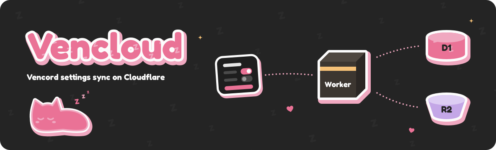

<p align="center">
  
</p>

<h1 align="center">Venflare</h1>

<p align="center">
  An experimental port of <a href="https://github.com/Vencord/Vencloud">Vencloud</a>,
  Vencord's Go cloud-sync API, to a Cloudflare Worker.
</p>

<p align="center">
  <a href="https://github.com/Vencord/Vencloud"></a>
  <a href="https://bun.sh"></a>
  <a href="https://developers.cloudflare.com/workers/"></a>
</p>

Keep your [Vencord](https://github.com/Vendicated/Vencord) settings in sync without running a Go server or Redis. This port uses a Worker for the API, D1 for account records, and a private R2 bucket for settings backups.

The goal is to work with existing Vencord clients. The tests cover OAuth, uploads, downloads, deletion, and timestamp ETags.

> [!WARNING]
> This is experimental. Keep an exported copy of your settings, and don't make this your only backup.
>
> This is a separate project, not an official Vencord service. Please report problems with this port here, not to the upstream support server.

## Self-hosting

You'll need:

- [Bun](https://bun.sh) 1.4.2 or newer.
- A Cloudflare account with [Workers Paid](https://developers.cloudflare.com/workers/platform/pricing/), D1, and R2 enabled. Cloudflare usage is billed to your account.
- A [Discord application](https://discord.com/developers/applications) for OAuth.

Workers provides HTTPS. There's no reverse proxy or Docker container to configure.

### 1. Install

From the project directory:

```sh
bun install
bun sst install
cp .env.example .env
```

Open `.env` and fill in `CLOUDFLARE_API_TOKEN` and `CLOUDFLARE_DEFAULT_ACCOUNT_ID`. Don't commit that file.

Create the token using Cloudflare's **Edit Cloudflare Workers** template, with **Account → D1 → Edit** added. For a custom domain, also add **Zone → DNS → Edit** for its zone. The [SST Cloudflare guide](https://sst.dev/docs/cloudflare/#credentials) covers the token setup.

### 2. Set up Discord

Create an application in the [Discord Developer Portal](https://discord.com/developers/applications). You'll need its **Application ID** and **OAuth2 Client Secret**. You don't need to create a bot.

Under **OAuth2 → Redirects**, add:

```text
https://your-worker-address/v1/oauth/callback
```

That address must exactly match the `DiscordRedirectUri` value below. This API only requests the `identify` scope.

Don't know your Worker address yet? You can temporarily use `https://example.com/v1/oauth/callback` to get through the first startup. Once SST prints your API URL, add the real callback in Discord and update `DiscordRedirectUri`. Sign-in won't work until those addresses match.

### 3. Set the application secrets

Set them with SST. Leave off the value and the CLI prompts you for it:

```sh
bun sst secret set DiscordClientId
bun sst secret set DiscordClientSecret
bun sst secret set DiscordRedirectUri
```

These commands use your personal SST stage. SST generates the two peppers for you, so there's nothing to copy from the Go server.

### 4. Start it

```sh
bun dev
```

SST creates the Cloudflare resources, generates `sst-env.d.ts`, starts the Worker build watcher, and opens Drizzle Studio. Wait for the deployment to finish and note the `api` URL.

In another terminal, apply the database migrations:

```sh
bun run db:migrate
```

Check the API:

```sh
curl https://your-worker-address/v1
```

You should get `{"ping":"pong"}`. If you used a temporary callback address, update it in Discord and with `bun sst secret set DiscordRedirectUri` now.

> [!NOTE]
> `sst dev` uses real Cloudflare resources. It isn't an offline server, and the resources stay around after you close it. Use your personal stage for development, not `production`.
>
> In a terminal without an interactive UI, use `bun dev --mode=mono`.

### 5. Connect Vencord

Open Vencord's **Cloud** settings:

1. Set **Backend URL** to your API's HTTPS address, without `/v1`.
2. Turn on **Enable Cloud Integrations** and authorize your Discord application.
3. Turn on **Enable Settings Sync**.

Try **Upload Settings** and **Download Settings** before relying on automatic sync. Repeat the setup on your other devices. Desktop Vencord may ask you to restart after allowing the new backend domain.

## Deploying

Production is a separate SST stage, with its own database, bucket, and application secrets:

```sh
bun sst secret set DiscordClientId --stage production
bun sst secret set DiscordClientSecret --stage production
bun sst secret set DiscordRedirectUri --stage production
bun run deploy --stage production
bun sst shell --stage production -- bun run --cwd packages/storage db:migrate
```

Use the production address in Discord's redirect list and in Vencord. Production doesn't copy your development database.

Want a custom domain? Set `DOMAIN` in `.env` before deploying. It must belong to a Cloudflare-managed zone. `DOMAIN` is only used outside dev mode; development uses the generated Worker URL.

## Configuration

Application secrets live in SST. Cloudflare credentials and the optional settings below go in `.env`:

| Variable        | Default              | What it does                                                                                       |
| --------------- | -------------------- | -------------------------------------------------------------------------------------------------- |
| `DOMAIN`        | Worker URL           | Custom domain for deployments outside dev mode.                                                    |
| `ALLOWED_USERS` | Everyone             | Comma-separated Discord user IDs allowed to sign in and sync.                                      |
| `SIZE_LIMIT`    | `32000000`           | Largest allowed backup, in bytes. You can lower it, but not above 32 MB.                           |
| `PROMETHEUS`    | `false`              | Exposes the registered-account gauge at `/metrics`.                                                |
| `SOURCE_URL`    | Unset                | Public source repository URL, linked from `/v1`. It's not a secret, and the app starts without it. |
| `ROOT_REDIRECT` | `SOURCE_URL`, if set | Where `/` redirects. If neither URL is set, `/` returns `{"ping":"pong"}`.                         |

`SOURCE_URL` and `ROOT_REDIRECT`, when set, must use HTTPS. Set `SOURCE_URL` to your own repository if you're publishing a modified version.

If you remove someone from `ALLOWED_USERS`, they can still delete their existing cloud settings and account.

## Working on the port

The SST app name remains `vencloud-worker` to preserve existing resource names. Changing it creates a separate deployment; it doesn't migrate stored settings.

The code is split into three Bun workspaces:

```text
packages/
  core/       Accounts, OAuth, crypto, and settings logic
  storage/    D1 queries, R2 uploads, schema, and migrations
  server/     HTTP routes, Discord client, and Worker runtime
infra/        SST resources
```

The API uses Elysia's v2 beta with a build-time AOT step, Effect v4 RC, and Drizzle v1 RC. These are pinned in the workspace `package.json` files. Builds, scripts, and tests run with Bun; the deployed API runs in workerd, not Bun.

```sh
bun run build
bun run test
bun run test:integration
bun run typecheck
bun run lint
bun run format:check
```

`bun run check` runs all of those checks. Integration tests use local workerd, D1, and R2 through Miniflare, with Discord mocked. They don't call the real Discord API or use your Cloudflare credentials.

Run `bun dev` to generate SST resource types before typechecking a fresh checkout. If application secrets are missing, SST can't generate the full types. Set the secrets instead of adding declarations by hand.

For schema changes:

```sh
bun run db:generate
bun run db:migrate
bun run db:studio
```

These use `sst shell` to load the linked database credentials. Review generated migrations before applying them. There's one Drizzle config in `packages/storage/drizzle.config.ts`.

## Data and backups

Settings are stored as the compressed bytes sent by Vencord. The server doesn't decompress them. This is not end-to-end encryption. Whoever runs the instance can read stored backups.

D1 stores keyed hashes of Discord user IDs, not the IDs themselves. It also stores a random account generation ID, the current backup pointer, and upload cleanup records. API secrets are derived with Web Crypto HMAC-SHA-256 rather than stored in the database. Discord access tokens are only used for the sign-in request. They aren't stored.

Each upload gets its own R2 object. A cleanup job runs hourly and removes uploads that are no longer current and older than an hour. Deleting settings or an account cuts off access to the current backup. The server also tries to delete that object right away. If that fails, the cleanup job removes it later, like any older upload. Cleanup records remain for seven days to catch delayed uploads. That is not a seven-day backup recovery feature.

Back up D1, R2, and the SST secrets together. Keep the two peppers with the database they belong to. Replacing a pepper can break existing credentials or make account records unreachable. This port does not include a Redis-to-D1 migration tool.

## Credits

[Vencloud](https://github.com/Vencord/Vencloud) provides the original Go API and HTTP protocol. [Vencord](https://github.com/Vendicated/Vencord) provides the client and settings-sync feature. Thanks to their contributors. This port builds on their work.

Vencloud is [AGPL-3.0 licensed](https://github.com/Vencord/Vencloud/blob/main/LICENSE); this port follows the [same license](LICENSE). If you run a modified version for other people, make its corresponding source available to them. Setting a source link alone doesn't replace that obligation.

This project is not affiliated with or endorsed by Discord, Cloudflare, or the Vencord project. Their names describe the services and software it works with.
